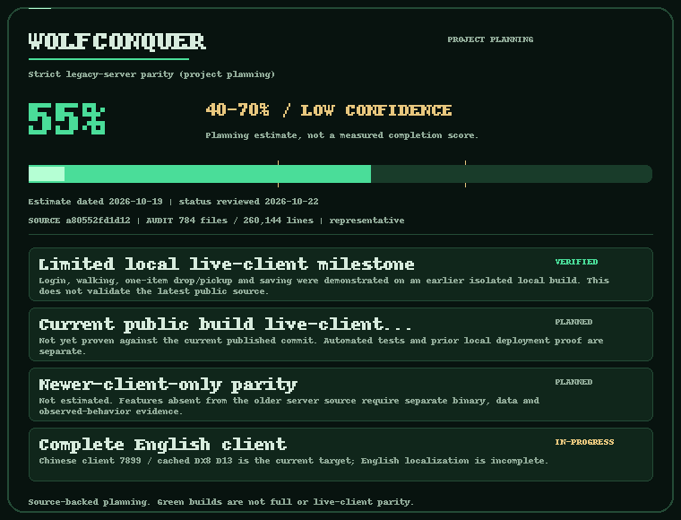

# WolfConquer

Engineering policy: [Sanitized Parity](docs/engineering/SANITIZED-PARITY.md) keeps
client-confirmed protocol compatibility while fixing unsafe source logic.
[Source-bug fixes and audit](FIXED-SOURCE-BUGS.md).
[Verified components and remaining work](docs/RECONSTRUCTION-STATUS.md).

[](https://github.com/vgcman16/wolfconquer/actions/workflows/windows-local.yml)
[](https://www.codefactor.io/repository/github/vgcman16/wolfconquer)
[](https://discord.gg/Cb5fsBHcK)

[](docs/PARITY.md)

The tracker shows a dated, low-confidence planning estimate, not measured
coverage or full-client completion.
[Progress, remaining systems and evidence limits](docs/PARITY.md).

WolfConquer is a C# implementation of server, packet, and data tooling for researching Conquer-compatible protocols. This repository contains a sanitized source snapshot, with a new Git history.

Join the [WolfConquer Discord](https://discord.gg/Cb5fsBHcK) for development
updates, testing discussions and bug reports. Warden posts public repository
commits and CI results in `#devlog`.

Windows-first [local development tools](docs/LOCAL-DEVELOPMENT.md) provide a
sequential check command and read-only localhost dashboard. The game does not
depend on GitHub to run. The build/test workflow is manually requested on trusted `main` by
the repository owner. Outside pull requests are never executed on the local PC.
Badges report checks or static analysis, not full parity or production readiness.

Experimental [client and source update tools](docs/CLIENT-UPDATES.md) provide
signed, curated client releases and clean-checkout source updates. A separate
Windows graphical launcher uses the same update engine. No official full-client
download feed or game-client assets are included or published by this snapshot.
The current target is Chinese client7899 / cached DX8 D13. English resource
tools and [configuration-decoding prerequisites](docs/CLIENT-RESOURCE-TOOLS.md)
remain separate from complete English or portable-client acceptance.

A downloadable [Windows launcher/updater tooling preview](https://github.com/vgcman16/wolfconquer/releases/tag/launcher-preview-20261028) is available.
It contains no game client, configuration or feed. See
[package contents and actual checks](docs/LAUNCHER-PREVIEW-20261028.md).

[Explicit saved-state startup and disposable fixture CLI](docs/OWNED-ADMISSION.md)
opens only a configured existing UID domain; it does not register an account or
complete native login.

## Build and test

Install a .NET SDK compatible with `global.json` (9.0.314, with roll-forward enabled). From the repository root:

```sh
dotnet restore WolfConquer.sln
dotnet build WolfConquer.sln -c Release --no-restore
dotnet test WolfConquer.sln -c Release --no-build --no-restore
```

Tests include local process and loopback HTTP/socket checks. The source was developed on Windows; platform-specific coverage and the exact publication validation results are recorded in [VALIDATION.md](VALIDATION.md). Tests requiring omitted external data are [explicitly skipped](docs/EXTERNAL-FIXTURE-TESTS.md).

The reconstructed native console/loader tests additionally require Windows and
a PowerShell 7 executable. Before the test command, set its explicit path and hash
in the same shell (the probes create only owned synthetic temporary inputs):

```powershell
$taskPwsh = (Get-Command pwsh -CommandType Application | Select-Object -First 1).Source
$env:WOLFCONQUER_NATIVE_CONSOLE_PROBE_PWSH = $taskPwsh
$env:WOLFCONQUER_NATIVE_CONSOLE_PROBE_PWSH_SHA256 = (Get-FileHash -LiteralPath $taskPwsh -Algorithm SHA256).Hash
```

This does not start or log into a game client. The legacy `MySql.Data` and
native-compatible `protobuf-net` packages emit NU1701 compatibility warnings;
see [dependency limits](DEPENDENCIES.md).

## Projects

| Project | Purpose |
|---|---|
| `WolfConquer.Core` | Packet handling, server behavior, data readers, and reusable client-file utilities |
| `WolfConquer.AccountServer` | Account service entry point |
| `WolfConquer.WorldServer` | World service entry point |
| `WolfConquer.Gateway` | Gateway entry point |
| `WolfConquer.LoginWeb` | Local HTTP service for explicitly configured loader responses |
| `WolfConquer.DataTool` | Command-line data, diagnostics, and client-file utilities |
| `WolfConquer.Tests` | Unit and integration tests using constructed fixtures |
| `WolfConquer.Updates` | Signed manifests, transactional installation, curated publishing, and source updates |
| `WolfConquer.Updater` | Standalone updater command-line entry point |
| `WolfConquer.Updates.Tests` | Synthetic signed-release, loopback, recovery, and local Git tests |
| `WolfConquer.Launcher` | Optional Windows WPF client/source updater with original artwork |
| `WolfConquer.Launcher.Tests` | Windows-only launcher presentation and integration tests |

The main solution includes the updater library, CLI, and updater tests. Build and
test the Windows WPF projects separately as described in the
[update-tool guide](docs/CLIENT-UPDATES.md#windows-launcher).

Use the data tool's help command to see its commands:

```sh
dotnet run --project src/WolfConquer.DataTool -- help
```

The repository does not include a game client, game assets, account database, captured network payload files, or a preconfigured live deployment. Supply your own authorized data and configuration where a command needs external files. See [PUBLICATION-SCOPE.md](PUBLICATION-SCOPE.md) for the snapshot boundary and changed optional features, [text catalogs](TEXT-CATALOGS.md) for client patch inputs, and [loader configuration](docs/LOADER-CONFIGURATION.md) for HTTP payloads and readiness checks.

Direct NuGet dependencies and their declared licenses are listed in [DEPENDENCIES.md](DEPENDENCIES.md). Those dependency licenses apply to the named packages; this snapshot does not add a blanket license for the project source.

For repeatable local gameplay checks, use the [testing tools](docs/LOCAL-TESTING-TOOLS.md),
[acceptance runner](tools/testing/SCENARIOS.md) and [scenario matrix](docs/testing/GAME-ACCEPTANCE-MATRIX.md).

See the [short progress checklist](docs/PROGRESS.md) and [contribution guidance](CONTRIBUTING.md).
